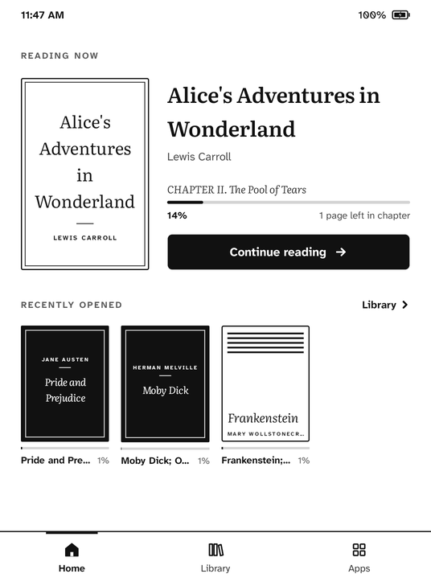
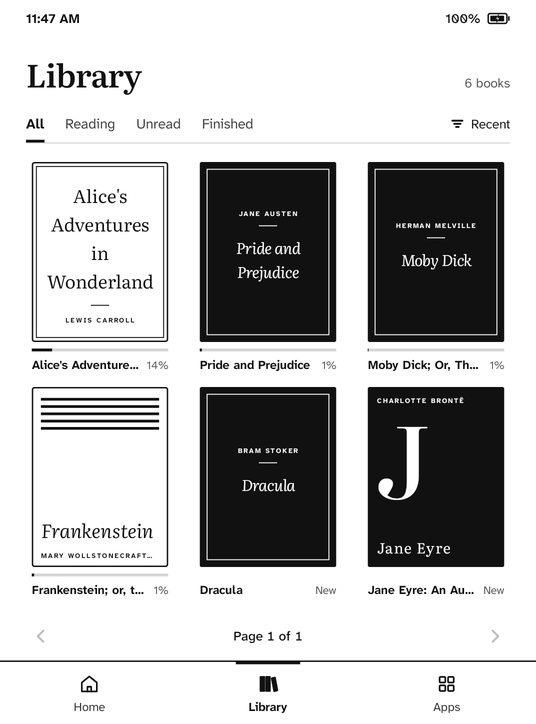
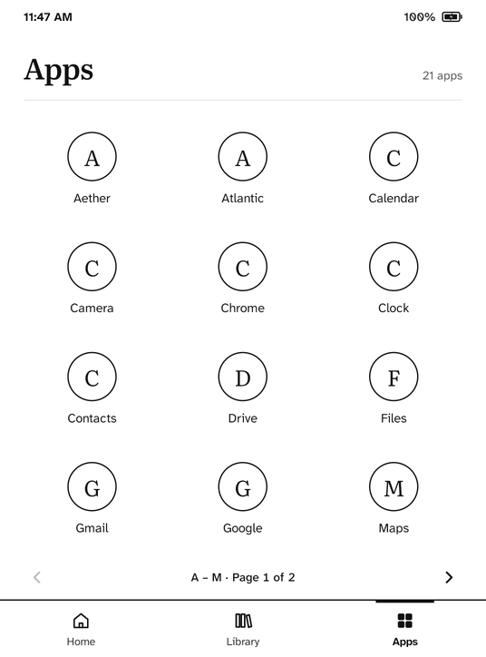
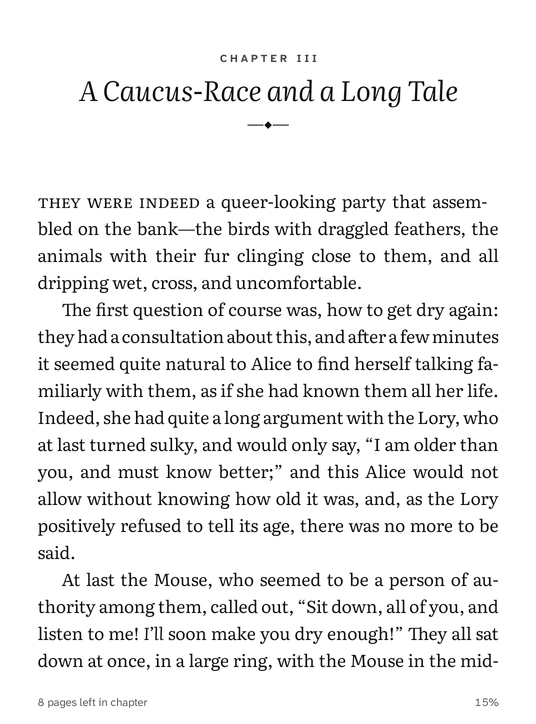
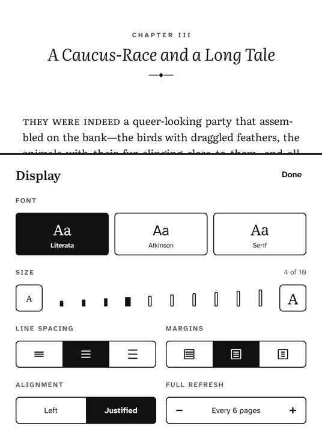
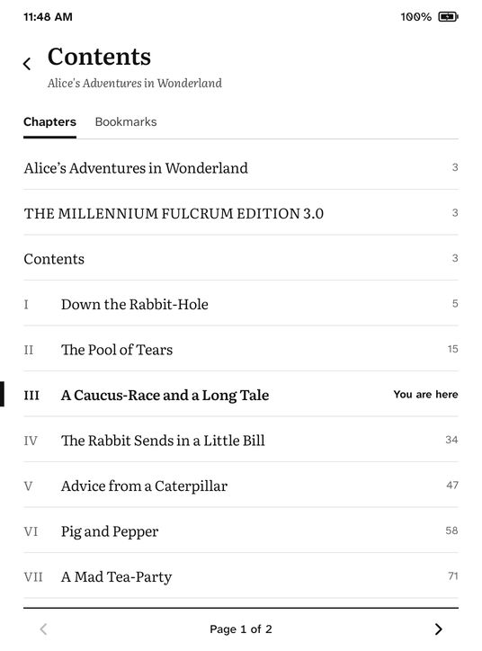
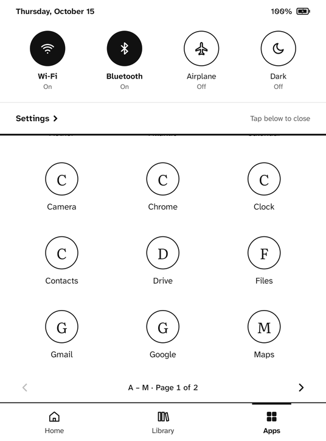
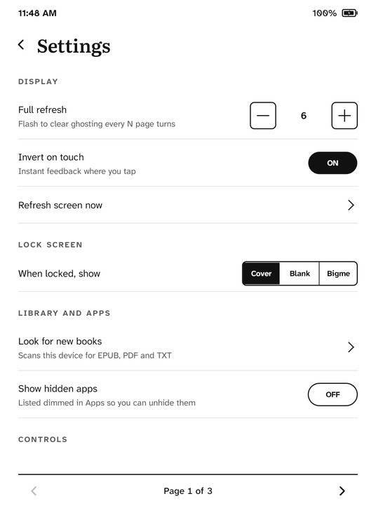

# PaperOS

A featherweight shell, e-book reader and custom ROM for e-ink Android tablets. It was built for
the **Bigme B6 Color** (MediaTek MT6765, Android 14, 6″ Kaleido 3), and it runs on any Android 8+
device, with a generic e-ink fallback.

Most Android apps and system services are designed for LCDs. PaperOS takes the opposite
approach:

- **Nothing moves.** There are no animations, no scrolling and no list views.
- **Everything is paged**, and every page is exactly full.
- **Only what changed is redrawn.** Idle on Home, the launcher draws one frame per minute, for the
  clock. A page turn is one frame.
- **Black and white first.** It uses two carefully chosen typefaces, 48 dp touch targets and
  inversion as touch feedback.
- **No bloat.** There's no AndroidX and no Google libraries. The whole app (shell, reader and
  fonts) is about 630 KB.

## Screens

Everything below is a real screenshot at the B6's resolution (1072 × 1448, 300 dpi).
The original high-fidelity designs of these screens
are on the [design canvas](https://claude.ai/artifact/HWhQy65vs4VSHzGb8gnfDJ).

<table>
  <tr>
    <td></td>
    <td></td>
    <td></td>
  </tr>
  <tr>
    <td align="center"><b>Home</b><br>Reading now, recently opened</td>
    <td align="center"><b>Library</b><br>Covers, filters, sort, pages</td>
    <td align="center"><b>Apps</b><br>Lettered circles, A–Z pages</td>
  </tr>
  <tr>
    <td></td>
    <td></td>
    <td></td>
  </tr>
  <tr>
    <td align="center"><b>Reading</b><br>Literata, justified, hyphenated</td>
    <td align="center"><b>Reader menu</b><br>Chapter ticks, time left</td>
    <td align="center"><b>Display</b><br>Steps, never sliders</td>
  </tr>
  <tr>
    <td></td>
    <td></td>
    <td></td>
  </tr>
  <tr>
    <td align="center"><b>Contents</b><br>Chapters and bookmarks</td>
    <td align="center"><b>Quick settings</b><br>From the top bar</td>
    <td align="center"><b>Settings</b><br>Paged, no scrolling</td>
  </tr>
</table>

## What's inside

| Path | What it is |
|---|---|
| [`paperui/`](paperui) | E-ink UI toolkit: paged grid and column, pager, status and tab bars, toggles and steppers, line icons drawn in code, a live clock and battery that redraw only on change, and a panel-refresh layer with Bigme, Rockchip and generic drivers |
| [`reader/`](reader) | Reader and library. Covers EPUB 2/3 (including in-file chapter anchors), TXT and PDF; typesetting with Android's own text engine; typographic covers; progress, bookmarks and time left; and the lock-screen image |
| [`launcher/`](launcher) | The PaperOS shell: Home, Library, Apps, quick settings and Settings |
| [`tools/debloat.sh`](tools/debloat.sh) | Reversible, no-root debloat and battery tuning for stock firmware |
| [`tools/rom/`](tools/rom) | The custom ROM pipeline for the B6: full backup, build, flash and restore |
| [`docs/`](docs) | [Design rules](docs/DESIGN.md), [research notes](docs/RESEARCH.md), [ROM notes](docs/ROM.md) |

### The reader

- **EPUB** is unpacked with the framework's zip and XML readers. Chapters are typeset with Android's
  own text engine:
  - **Body text:** justified with full hyphenation, set in Literata with real italics and bold.
  - **Chapter headings:** split into a letter-spaced label ("CHAPTER III"), an italic display title
    and an ornament; the opening words that follow are set in small caps.
  - **Pagination:** by whole lines, across a stack of blocks, so headings and images are never
    justified.
- **Position** is a chapter plus character offset, so it survives any change of font or size. Page
  numbers and "time left" are estimates; time left learns your reading pace.
- **PDF** uses Android's built-in renderer. **TXT** is split into chapters at paragraph breaks.

### E-ink rules the toolkit enforces

- **Damage is kept small by structure.** Each independently updating element (grid cell, clock,
  battery) is its own View. HWUI then reports a tight damage rectangle, and the panel updates only
  that region. Software rendering would report the whole buffer as changed.
- **Ghosting has a budget:** a full, clearing refresh happens every *N* page turns (configurable),
  never on a timer.
- **No animations, sliders or scrolling.** Steppers, pagers and swipe-to-turn replace them.

See [docs/DESIGN.md](docs/DESIGN.md) for all the rules and the sources behind them.

## Build and run

You need the Android SDK. Android Studio's bundled JDK is enough.

```bash
JAVA_HOME="/Applications/Android Studio.app/Contents/jbr/Contents/Home" ./gradlew :launcher:assembleRelease
adb install -r launcher/build/outputs/apk/release/launcher-release.apk
adb shell cmd package set-home-activity io.paperos.launcher/.HomeActivity
```

Put `.epub`, `.pdf` or `.txt` files anywhere on the device (for example `/sdcard/Books`). Then
grant "All files access" when the Library asks for it.

## The B6 Color ROM

[`tools/rom/`](tools/rom) turns Bigme's stock firmware into a PaperOS ROM. It ran end to end on a
real B6:

| Step | Script | What it does |
|---|---|---|
| Back up | `backup.sh` | Reads every partition except `userdata` through MediaTek's boot ROM ([mtkclient](https://github.com/bkerler/mtkclient)). No unlock is needed and nothing is written. The backup includes the device-unique `nvram`/`nvdata`/`protect` partitions and the e-ink `waveform` partition. |
| Unpack | `unpack.sh` | Splits the 12 GB `super` image into its logical partitions: system, system_ext, product and vendor. On the B6 they're plain ext4. |
| Build | `build_rom.py` + `rom.txt` | Edits the stock ext4 images in place with `debugfs`. It removes 61 apps (Bigme bloat, Google, phone apps and the stock launchers) and adds PaperOS as a privileged system app, plus F-Droid, HeliBoard and EinkBro. It sets properties and permission files, and turns off AVB verification. SELinux labels are written byte-for-byte like Bigme's own. |
| Flash | `flash.sh`, `flash_part.sh` | Unlocks `seccfg`, writes the ROM, and wipes data. `flash_part.sh` rewrites only the changed logical partitions at their exact flash offsets, in minutes instead of 35. |
| Restore | `restore.sh` | Writes the factory system, verification data and the bootloader lock back from the backup, then wipes data. This returns the tablet to factory state; it was tested on the device. |

What we learned on the hardware is written up in [docs/ROM.md](docs/ROM.md), including:
- the boot loop caused by removing the misleadingly named `GoogleExtShared`
- Bigme's front-light API (`android.hwebook.Xrzebook`, with cold and warm channels)
- the sleep-screen file `/data/xrz/standby.png`
- the per-app display policy (`DisplayPolicyManager`)

> ⚠️ Flashing writes to your device and voids its warranty. Only use these scripts with your own
> backup, and read [docs/ROM.md](docs/ROM.md) first.

## Status

**Done**
- Toolkit, shell and reader, verified in the emulator at B6 resolution.
- ROM pipeline. Backup, build, flash and restore all ran on a real B6, and the ROM booted into
  PaperOS.

**Open**
- **Sharpness on Kaleido 3.** Bigme applies colour processing to apps it doesn't know. PaperOS
  should register itself as black-and-white through Bigme's display policy.
- **USB debugging on the ROM.** Bigme's settings switch didn't enable adb, so it should be enabled
  from the ROM.
- **Quick-settings switches, front light and warmth, dark mode, and the lock-screen cover.** These
  are implemented for the ROM, where PaperOS is a privileged system app, but not yet verified on
  hardware.
- **Our own Wi-Fi, Bluetooth and language pages** in Settings, plus a calendar app on the toolkit.
- **Reader:** search, highlights, dictionary and tappable footnotes.

## Credits

- [Literata](https://github.com/googlefonts/literata) and
  [Atkinson Hyperlegible Next](https://www.brailleinstitute.org/freefont/), both under the SIL
  Open Font License (see `paperui/src/main/assets/fonts/`).
- [mtkclient](https://github.com/bkerler/mtkclient) and
  [lpunpack](https://github.com/unix3dgforce/lpunpack) are downloaded by `tools/rom/setup-mtkclient.sh`.
- Bigme API findings build on [inksdk](https://github.com/imedwei/inksdk) and
  [hibreak-pro-color](https://github.com/awong-dev/hibreak-pro-color).

## License

PaperOS is released under the [MIT License](LICENSE). The bundled fonts keep their own license,
the SIL Open Font License 1.1 (see `paperui/src/main/assets/fonts/`).
